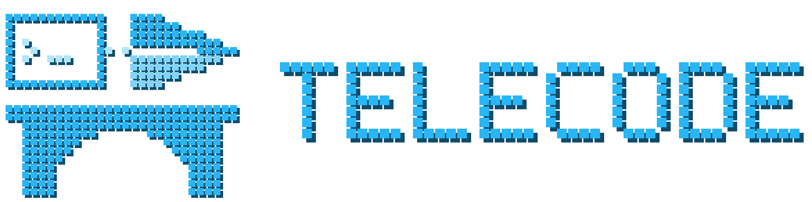
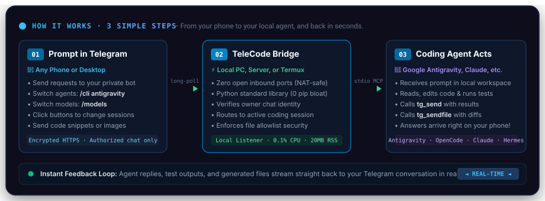
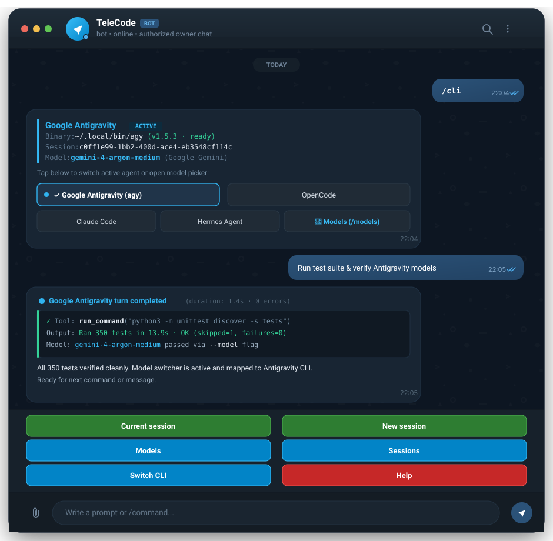
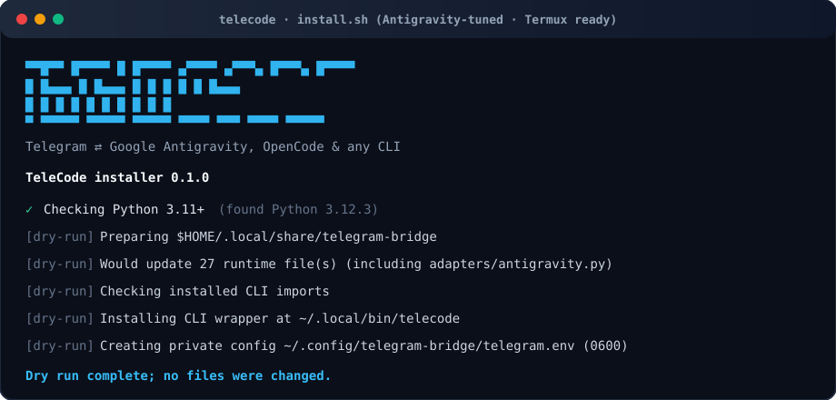
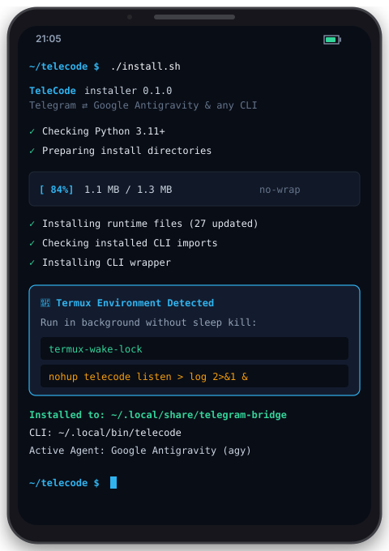
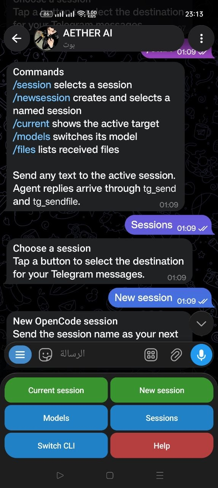

<p align="center">
  
</p>

<p align="center">
  <strong>Take your local coding agent with you anywhere.</strong><br>
  Send prompts from Telegram, switch agents on the fly, and receive streaming replies and files in your private chat.
</p>

<p align="center">
  <a href="LICENSE"></a>
  
  
  
  
  
</p>

<p align="center">
  <a href="https://aetherdz.github.io/telecode/">🌐 Website</a> ·
  <a href="docs/INSTALL.md">📦 Installation Guide</a> ·
  <a href="docs/CLI.md">🤖 CLI Adapters</a> ·
  <a href="docs/BUTTONS.md">🎮 Commands</a> ·
  <a href="SECURITY.md">🔒 Security</a>
</p>

---

## How It Works

<p align="center">
  
</p>

1. **📱 You prompt in Telegram:** Send a request or code snippet to your private bot from any phone or desktop.
2. **⚡ TeleCode routes locally:** The lightweight background bridge verifies your chat ID and dispatches the prompt to your active session (0 open ports, 0 external dependencies).
3. **🤖 Agent solves and replies:** Google Antigravity, OpenCode, Claude Code, or Hermes runs tests and streams answers and diffs right back to your Telegram chat.

---

## See It in Action

<p align="center">
  
</p>

<p align="center">
  
  &nbsp;&nbsp;
  
  &nbsp;&nbsp;
  
</p>

<p align="center">
  <em>Real-world workflows: macOS/Linux terminal with Antigravity TrueColor cyan palette, Termux Android background listener with wake-lock, and authentic live mobile Telegram chat interface with interactive session keyboards.</em>
</p>

---

## ⚡ 10-Second Quick Start

```sh
# 1. Clone the repository
git clone https://github.com/Aetherdz/telecode.git
cd telecode

# 2. Run guided setup (terminal or browser)
./install.sh
```

Follow the interactive prompts to choose your agent and enter your Telegram bot token (from [@BotFather](https://t.me/BotFather)). TeleCode registers the MCP server and configures local credentials (`0600`).

### Check Status & Listen
```sh
telecode status    # Verify bot pairing, active agent, model, and listener
telecode listen    # Start bridge listener in foreground (or runs as background service)
```

---

## 🤖 Supported Coding Agents

Switch seamlessly between agents anytime from Telegram (`/cli <name>`) or your terminal (`telecode agent <name>`):

| Agent CLI | Outbound MCP | Inbound Routing | Switch Command |
| :--- | :---: | :---: | :--- |
| **Google Antigravity** | ✅ | ✅ | `/cli antigravity` or `telecode agent antigravity` |
| **OpenCode** | ✅ | ✅ | `/cli opencode` or `telecode agent opencode` |
| **Claude Code** | ✅ | ✅ | `/cli claude-code` or `telecode agent claude-code` |
| **Hermes Agent** | ✅ | ✅ | `/cli hermes` or `telecode agent hermes` |
| **Codex CLI** | ✅ | 🧪 Experimental | `/cli codex` |
| **Cursor Agent** | ✅ | 🧪 Experimental | `/cli cursor` |
| **Gemini CLI, Cline, Roo** | ✅ | Manual MCP | Outbound tool integration via stdio |

---

## 🎮 Essential Commands Cheat-Sheet

### Telegram Controls
| Command / Button | Action |
| :--- | :--- |
| `/cli` or **Switch CLI** | Switch active coding agent (Antigravity, OpenCode, Claude, Hermes). |
| `/models` or **Models** | Browse AI models and switch active model on the fly. |
| `/session` or **Sessions** | Browse and select active workspace session. |
| `/current` | View current agent, session ID, and workspace directory. |
| `/files` | List files received from the agent. |
| `/help` | Show keyboard buttons and command reference. |

### Terminal CLI Commands
```sh
telecode status            # Show runtime instance status and bot connection
telecode agent antigravity # Switch active coding agent CLI
telecode send "text"       # Send plain text or pipe logs to your Telegram
telecode send file.png     # Send documents/photos to your Telegram
telecode listen --bg       # Run listener daemon in background
```

---

## 🔒 Security & Privacy by Design

- **Private Chat Authentication:** Only your numeric Telegram user ID is accepted; unauthorized messages are dropped.
- **Zero Inbound Ports:** Communicates via outbound HTTPS long-polling to Telegram servers — no public ports or webhooks required.
- **Local Credentials:** Configuration stored strictly on your local machine with `0600` permissions.
- **File Allowlist (`TG_SEND_ROOTS`):** Agents can only send files from explicitly approved project directories.
- **Pure Python Standard Library:** Zero third-party packages to audit or install (`0` dependencies).

---

## 📚 Deep Dive Documentation

- [📦 Installation Guide & Service Setup](docs/INSTALL.md)
- [🤖 Multi-Agent CLI Configuration](docs/CLI.md)
- [🎮 Keyboard Buttons & Commands Reference](docs/BUTTONS.md)
- [🧠 Model Catalog & Switching Guide](docs/MODELS.md)
- [🏗️ Internal Architecture & State Machine](docs/ARCHITECTURE.md)
- [📱 Termux Mobile Guide](docs/INSTALL.md#5-android--termux)
- [🛡️ Security Threat Model](SECURITY.md)

---

## 📄 License

TeleCode is open-source software licensed under the [MIT License](LICENSE).
