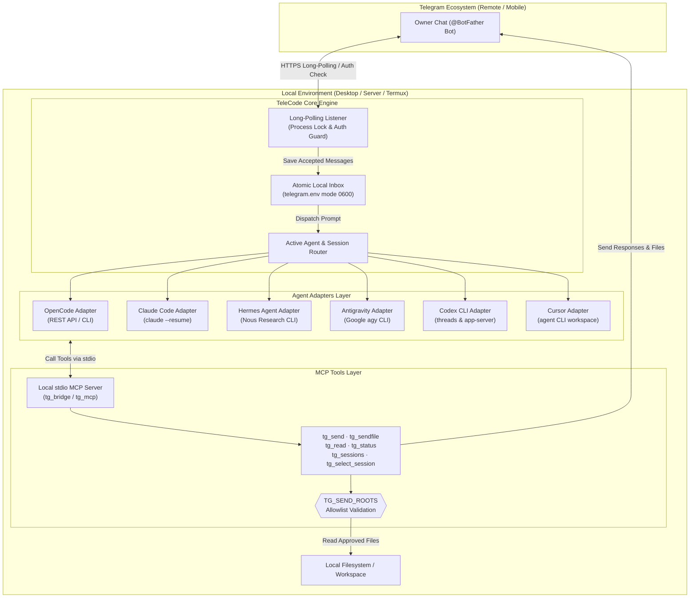

<p align="center">
  
</p>

<p align="center">
  <strong>Take your local coding-agent session with you.</strong><br>
  Send prompts from Telegram, choose a session, and receive agent replies in your owner chat.
</p>

<p align="center">
  <a href="LICENSE"></a>
  
  
  
  
  
</p>

<p align="center">
  
</p>

<p align="center">
  <a href="https://aetherdz.github.io/telecode/">Website</a> ·
  <a href="docs/INSTALL.md">Installation</a> ·
  <a href="docs/CLI.md">CLI support</a> ·
  <a href="SECURITY.md">Security</a> ·
  <a href="CHANGELOG.md">Changelog</a>
</p>

---

## Feature overview

- **Telegram control:** send prompts and attachments from your authorized private Telegram owner chat.
- **Universal CLI switching:** switch on the fly between OpenCode, Claude Code, Hermes Agent, Google Antigravity, Codex CLI, and Cursor via Telegram keyboard, `/cli <name>`, or `telecode agent <name>`.
- **Session management:** browse, create, select, and inspect local coding agent sessions.
- **Model switching:** browse providers and models without editing local configuration.
- **MCP integration:** receive agent replies and approved files through a local stdio MCP server.
- **Privacy by default:** no public web endpoint, owner-chat authorization, local credentials (`0600`), and an allowlist for outgoing files.
- **Android & Termux ready:** native responsive terminal TUI, non-wrapping compact download progress, and background wake-lock support for mobile devices.
- **Simple deployment:** Python standard library runtime, guided browser or terminal setup, foreground listener, or per-user system service.

## What is TeleCode?

TeleCode connects your private Telegram chat to local coding-agent CLI workflows. Send a message or attachment to your bot, route it to the session you selected, and let the agent reply using the included MCP tools.

It is a deliberately narrow bridge: **no public web endpoint, no shell exposed to Telegram, and no extra model or prompt router in the message path.**

```text
 ┌──────────────────────────────────────────────────────────────┐
 │              Telegram Owner Chat (Mobile / Desktop)          │
 └──────────────────────────────┬───────────────────────────────┘
                                │ HTTPS (Long-Polling & Auth Check)
                                ▼
 ┌──────────────────────────────────────────────────────────────┐
 │                     TeleCode Core Bridge                     │
 │  ┌────────────────────────────────────────────────────────┐  │
 │  │ Listener Process (PID Lock · 0600 Config · Inbox)      │  │
 │  └───────────────────────────┬────────────────────────────┘  │
 │                              │ Dynamic Routing & Hot-Reload  │
 │  ┌───────────────────────────▼────────────────────────────┐  │
 │  │              Multi-Agent Adapter Engine                │  │
 │  │  • OpenCode        • Claude Code     • Hermes Agent    │  │
 │  │  • Antigravity     • Codex CLI       • Cursor Agent    │  │
 │  └───────────────────────────┬────────────────────────────┘  │
 │                              │ stdio MCP Tool Calls          │
 │  ┌───────────────────────────▼────────────────────────────┐  │
 │  │  Local stdio MCP Server (tg_send, tg_sendfile, status) │  │
 │  │  [Security Boundary: TG_SEND_ROOTS Allowlist Enforced] │  │
 │  └────────────────────────────────────────────────────────┘  │
 └──────────────────────────────────────────────────────────────┘
```

## See it in action

<p align="center">
  
</p>

<p align="center">
  <em>Control coding agents (Google Antigravity, OpenCode, Claude Code, Hermes) directly from Telegram with instant inline switching and turn execution updates.</em>
</p>

<p align="center">
  
  &nbsp;&nbsp;
  
  &nbsp;&nbsp;
  
</p>

<p align="center">
  <em>Real-world workflows: macOS/Linux terminal with Antigravity TrueColor cyan palette (<code>#30B3EF</code>), Termux Android background listener with wake-lock, and authentic live mobile Telegram chat interface with interactive session keyboards.</em>
</p>

## Supported coding agents

| Client | Outbound MCP tools | Inbound session routing | Adapter details |
| --- | :---: | :---: | --- |
| **OpenCode** | Yes | Yes (Default) | REST API & CLI session discovery and prompt injection |
| **Claude Code** | Yes | Yes | Headless `claude --resume` adapter (`TELECODE_AGENT=claude-code`) |
| **Hermes Agent** | Yes | Yes | Nous Research Hermes CLI adapter (`TELECODE_AGENT=hermes`) |
| **Google Antigravity** | Yes | Yes | Google Antigravity CLI (`agy`) adapter with live model selection (`TELECODE_AGENT=antigravity`) |
| **Codex CLI** | Yes | Experimental | Local threads & `codex queue` (`TELECODE_AGENT=codex`, 0.166.0+) |
| **Cursor** | Yes | Experimental | Cursor Agent CLI and local metadata (`TELECODE_AGENT=cursor`) |
| **Gemini CLI, Cline, Roo, Q** | Yes | Outbound only | Outbound MCP tools enabled via configuration |
| **Continue, Aider, others** | Manual | Outbound only | stdio MCP configuration |

---

## Quick start

### Requirements

- Linux with systemd, macOS with LaunchAgents, Windows with Task Scheduler, or Android with Termux.
- Python 3.11 or newer and Git.
- A Telegram bot token from [@BotFather](https://t.me/BotFather).
- Your numeric Telegram chat ID, or choose automatic detection by messaging your bot.
- A supported coding agent (OpenCode, Claude Code, Hermes Agent, Antigravity, Codex, Cursor).

### Install from source

```sh
git clone https://github.com/Aetherdz/telecode.git
cd telecode
./install.sh
```

Run `telecode` with no arguments for the interactive menu, or `./install.sh` for the full guided setup. Setup registers the MCP server, stores credentials locally in `telegram.env` (`0600`), and enables a per-user startup service.

On headless machines or Termux where system services are unavailable, setup provides the foreground command (`telecode listen`).

### Terminal & Browser setup wizards

The interactive installer offers **Browser** (recommended) or **Terminal** wizards:
- Browser wizard: `./install.sh --web` or `telecode setup --web` (binds to `127.0.0.1`, one-time expiring link).
- Terminal wizard: `./install.sh --cli` or `telecode setup --cli` (4-step guided wizard with keyboard navigation).

```sh
telecode status    # Check bot, listener, session target, and unread messages
telecode listen    # Run bridge listener in foreground
```

---

## Agent CLI Switcher

TeleCode lets you switch between local coding agents seamlessly without restarting your bridge:

### 1. Switch from Telegram
- Tap the **Switch CLI** button on your main Telegram keyboard, or send `/cli` or `/agent`.
- Choose your desired agent from the inline keyboard:
  `[OpenCode] [Claude Code] [Hermes Agent] [Antigravity] [Codex] [Cursor]`
- Or pass the name directly: `/cli hermes` or `/cli antigravity`.
- Switching automatically routes subsequent prompts to the newest session of the selected agent.

### 2. Switch from the Terminal
```sh
# View currently active agent and status
telecode agent

# Switch active agent CLI
telecode agent hermes
telecode agent antigravity
telecode agent claude-code
telecode agent opencode
```

### 3. Persistent Configuration
Set your default agent in `${XDG_CONFIG_HOME:-~/.config}/telecode/telegram.env`:
```sh
TELECODE_AGENT=antigravity  # options: opencode, claude-code, hermes, antigravity, codex, cursor
```

---

## Sending text and files

Send text or files to your Telegram chat from the command line or scripts:

```sh
# 1. Send plain text
telecode send "Build test suite completed with 0 errors."

# 2. Smart auto-detection (detects file path and sends as document/photo)
telecode send ./build/telecode.zip "Production release archive"

# 3. Explicit file flag
telecode send --file ./coverage.svg "Test coverage report"

# 4. Pipe command output or logs directly via stdin
git diff HEAD~1 | telecode send
tail -n 30 /var/log/syslog | telecode send

# 5. Interactive prompt
telecode send
```

You can also use Option 6 ("Send a message") in the interactive `telecode menu`.

---

## Android & Termux Support

TeleCode is fully optimized for mobile devices and narrow terminals running Android via Termux:

### 1. Install Prerequisites in Termux
```sh
pkg update && pkg upgrade
pkg install python git termux-api
```

### 2. Clone & Run Guided Setup
```sh
git clone https://github.com/Aetherdz/telecode.git
cd telecode
./install.sh --cli
```

### 3. Background Execution & Wake Lock
To prevent Android from suspending the listener when the screen turns off:
```sh
# Acquire wake lock so the listener polls continuously
termux-wake-lock

# Start TeleCode in the background
nohup telecode listen > ~/.telecode/listener.log 2>&1 &
```

### 4. Storage Access
To allow coding agents to send screenshots or files stored on Android storage:
```sh
termux-setup-storage
```
Then add `/sdcard` or your workspace directory to `TG_SEND_ROOTS` in `~/.config/telegram-bridge/telegram.env`.

---

## Architecture



---

## Telegram controls

| Control | What it does |
| --- | --- |
| `Sessions` / `/session` | Browse available sessions and select the active target. |
| `Current session` / `/current` | Show the active agent, session title, and session ID. |
| `New session` | Enter a name, create a session, and select it for subsequent messages. |
| `Switch CLI` / `/cli` / `/agent` | Open inline picker to switch active coding agent, or switch directly with `/cli <name>`. |
| `Enter session ID` / `/entersession` | Enter and verify a full session ID, including one missing from the picker. |
| `Models` / `/models` | Browse providers and models, then switch the active session model. |
| `Help` / `/help` | Show available controls. |
| `/files` | List recent files received for the active session. |
| Any other text | Route the message to the active session. |

---

## MCP tools

| Tool | Purpose |
| --- | --- |
| `tg_send` | Send a text reply to the configured owner chat. |
| `tg_sendfile` | Send a local file from the configured `TG_SEND_ROOTS` allowlist. |
| `tg_read` | Read a bounded number of unread owner messages. |
| `tg_status` | Report bot, listener, session target, delivery mode, and unread count. |
| `tg_sessions` | List available sessions in the active agent. |
| `tg_select_session` | Select a session by its exact ID. |
| `tg_open_session_picker` | Send the session picker to Telegram. |

For safety, `tg_sendfile` rejects paths outside the configured allowlist and blocks sensitive locations.

---

## Security model

- Incoming messages are accepted only from the configured owner chat; callback actions also verify the sender.
- The bot token and chat ID are kept in a user-owned `telegram.env` file with mode `0600`.
- `tg_sendfile` is confined to `TG_SEND_ROOTS` and a sensitive-path deny list.
- The listener uses a process lock to prevent competing Telegram pollers.
- Telegram messages and attachments are untrusted input; content is routed to the agent, not treated as trusted instructions by the bridge.

Read [SECURITY.md](SECURITY.md) for the full threat model and hardening guidance.

---

## Documentation

- [Installation and startup](docs/INSTALL.md)
- [CLI integrations and configuration](docs/CLI.md)
- [Buttons and commands](docs/BUTTONS.md)
- [Telegram interaction skill](SKILL.md)
- [Architecture and local state](docs/ARCHITECTURE.md)
- [Model catalogue and switching](docs/MODELS.md)
- [Roadmap](docs/ROADMAP.md)
- [Changelog](CHANGELOG.md)
- [Project website](https://aetherdz.github.io/telecode/)

---

## Development

The runtime has zero third-party Python dependencies. Run the repository checks before submitting changes:

```sh
make check
make test
```

`make check` runs Python compilation, shell and JavaScript syntax checks, and an HTML parse. `make test` runs the unittest suite.

---

## License

TeleCode is released under the [MIT License](LICENSE).
