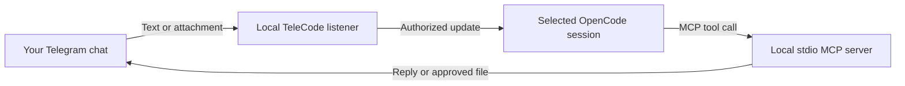

<p align="center">
  
</p>

<p align="center">
  <strong>Take your local coding-agent session with you.</strong><br>
  Send prompts from Telegram, choose a session, and receive agent replies in your owner chat.
</p>

<p align="center">
  <a href="LICENSE"></a>
  
  
  
</p>

<p align="center">
  <a href="https://aetherdz.github.io/telecode/">Website</a> ·
  <a href="docs/INSTALL.md">Installation</a> ·
  <a href="docs/CLI.md">CLI support</a> ·
  <a href="SECURITY.md">Security</a>
</p>

---

## What is TeleCode?

TeleCode connects your private Telegram chat to local coding-agent CLI workflows. Send a message or attachment to your bot, route it to the session you selected, and let the agent reply using the included MCP tools.

It is a deliberately narrow bridge: **no public web endpoint, no shell exposed to Telegram, and no extra model or prompt router in the message path.**

## Highlights

- **Control your OpenCode sessions from Telegram:** browse sessions, see the active target, and switch sessions without editing config files.
- **Choose a model on the go:** browse providers and paginated model lists; apply a choice to the active OpenCode session.
- **Send context both ways:** route text, photos, and documents into the selected session; let the agent send text or approved local files back.
- **Use MCP-compatible clients:** outbound Telegram tools work through a local stdio MCP server. Inbound session routing currently requires OpenCode.
- **Keep the boundary local and private:** only the configured owner chat is accepted; credentials live in a private runtime config.
- **Install without a build step:** Python 3.11+ standard library runtime, guided setup, and optional systemd user service.

## Quick start

### Requirements

- Linux with systemd user services for the guided service setup.
- Python 3.11 or newer and Git.
- A Telegram bot token from [@BotFather](https://t.me/BotFather).
- Your numeric Telegram chat ID, or the option to detect it by messaging your bot.
- OpenCode for Telegram-to-session prompt routing. Other MCP clients can use outbound tools; see [CLI support](docs/CLI.md).

### Install from source

```sh
git clone https://github.com/Aetherdz/telecode.git
cd telecode
./install.sh
```

The installer guides you through CLI selection, MCP registration, bot credentials, and service setup. Review the source and the [installation guide](docs/INSTALL.md) before running it. For an update from a source checkout, use `./install.sh --update`.

After setup, restart your coding-agent CLI so it loads the MCP server. Check the bridge with:

```sh
telecode status
```

## How it works



The listener long-polls Telegram, checks incoming messages against the configured owner chat, stores accepted messages in the local inbox, and injects them into the selected session. The coding agent replies through `tg_send` or `tg_sendfile`.

## Telegram controls

| Control | What it does |
| --- | --- |
| `Sessions` / `/session` | Browse available sessions and select the active target. |
| `Current session` / `/current` | Show the active session and its ID. |
| `Models` / `/models` | Browse providers and models, then switch the active OpenCode session. |
| `Help` / `/help` | Show available controls. |
| `/files` | List recent files received for the active session. |
| Any other text | Route the message to the active session. |

The keyboard labels are exact-match English text. Session selection is global to this bridge instance. See [Buttons and commands](docs/BUTTONS.md) for picker behavior and edge cases.

## MCP tools

| Tool | Purpose |
| --- | --- |
| `tg_send` | Send a text reply to the configured owner chat. |
| `tg_sendfile` | Send a local file from the configured `TG_SEND_ROOTS` allowlist. |
| `tg_read` | Read a bounded number of unread owner messages. |
| `tg_status` | Report bot, listener, session target, delivery mode, and unread count. |
| `tg_sessions` | List available OpenCode sessions. |
| `tg_select_session` | Select a session by its exact ID. |
| `tg_open_session_picker` | Send the session picker to Telegram. |

For safety, `tg_sendfile` rejects paths outside the configured allowlist and blocks sensitive locations. Telegram's hosted Bot API currently limits new uploads to **10 MB for photos** and **50 MB for other files**; a self-hosted Local Bot API Server can raise uploads to **2000 MB**, with additional hosting and bandwidth requirements. See [Telegram's official Bot API documentation](https://core.telegram.org/bots/api#using-a-local-bot-api-server) and TeleCode's [security notes](SECURITY.md).

## CLI support

| Client | Outbound MCP tools | Inbound session routing |
| --- | :---: | :---: |
| OpenCode | Yes | Yes — current supported adapter |
| Claude Code | Yes | No — adapter intentionally fails closed |
| Codex CLI, Cursor, Gemini CLI, Cline, Roo Code, Amazon Q | Yes | No |
| Continue, Aider, other MCP clients | Manual setup | No |

MCP support and session-routing support are separate capabilities. Installing the MCP server in another client does **not** make that client an inbound Telegram target. Check [CLI integrations](docs/CLI.md) for setup details.

## Security model

- Incoming messages are accepted only from the configured owner chat; callback actions also verify the sender.
- The bot token and chat ID are kept in a user-owned `telegram.env` file with mode `0600`.
- `tg_sendfile` is confined to `TG_SEND_ROOTS` and a sensitive-path deny list.
- The listener uses a process lock to prevent competing Telegram pollers.
- Telegram messages and attachments are untrusted input; content is routed to the agent, not treated as trusted instructions by the bridge.

Read [SECURITY.md](SECURITY.md) for the full threat model and hardening guidance. Report vulnerabilities privately using the process described there.

## Documentation

- [Installation and startup](docs/INSTALL.md)
- [CLI integrations and configuration](docs/CLI.md)
- [Buttons and commands](docs/BUTTONS.md)
- [Model catalogue and switching](docs/MODELS.md)
- [Architecture and local state](docs/ARCHITECTURE.md)
- [Roadmap](docs/ROADMAP.md)
- [Changelog](CHANGELOG.md)
- [Project website](https://aetherdz.github.io/telecode/)

## Development

The runtime has no third-party Python dependency. Run the repository checks before submitting changes:

```sh
make check
make test
```

`make check` runs Python compilation, shell and JavaScript syntax checks, and an HTML parse. `make test` runs the unittest suite.

## License

TeleCode is released under the [MIT License](LICENSE).
