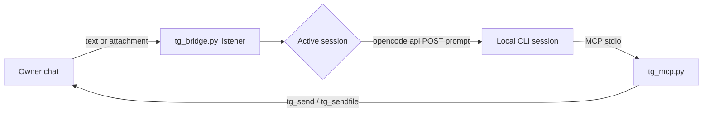

<p align="center"></p>

# TeleCode

TeleCode is an owner-only Telegram control surface for local coding-agent CLI sessions.
It routes Telegram messages and attachments into the session you select, and lets the
agent reply through MCP tools.

[](LICENSE)


-lightgrey.svg)

## Why TeleCode

Coding-agent CLIs are excellent at long-running local work, but they keep you at the
terminal. TeleCode gives one owner chat a narrow, explicit control channel: pick a
session, send text or files, and receive the agent's output without exposing a shell
or a web endpoint. There is no prompt router and no second model in the path. The
message goes to the local session, and the agent decides how to answer.

## Features

## Install

Clone the source so you can inspect it before running the installer:

```sh
git clone https://github.com/Aetherdz/telecode.git
cd telecode
./install.sh
```

The guided setup uses arrow keys and Enter to choose a detected CLI. It then
asks for a Telegram token from **@BotFather** and your numeric owner ID (available
from **@Getmyid_bot**) or offers automatic detection through your own bot. See
[the full installation guide](docs/INSTALL.md) for supported platforms and details.

- Owner-only listener: the configured chat is checked on all messages; sender
  identity is checked when present, and both chat and sender are checked for callbacks.
- Telegram reply keyboard with session, current-session, model,
  and help controls.
- Paginated session picker that lists all available sessions in batches and switches
  a single active target without editing environment files or source.
- Bottom reply-keyboard model picker for providers and paginated model lists, then
  applies a model switch to the active session through OpenCode.
- Inbound text, documents, and photos routed into the selected session; attachments
  are captured against the session that was active when they arrived.
- Outbound MCP tools for the agent: `tg_send`, `tg_sendfile`, `tg_read`,
  `tg_status`, `tg_sessions`, `tg_select_session`, `tg_open_session_picker`.
- Backup-first installer with atomic writes, mode preservation, and an explicit
  confirmation before any CLI config is changed.
- Stdlib-only Python 3.11+ runtime with no build step; optional systemd user service
  for autostart.

## How it works



The listener long-polls Telegram. Owner messages are appended to `inbox.jsonl` and
queued for injection into the active session. The agent reaches the owner through
the MCP server, which runs as a stdio subprocess of the CLI.

## Quick start

```sh
git clone https://github.com/aetherdz/telecode.git
cd telecode
./install.sh
```

For a scripted, non-interactive file install, use `./install.sh --bootstrap`.
For a full terminal onboarding, run `./install.sh` directly. The installer copies the runtime into
`${XDG_DATA_HOME:-$HOME/.local/share}/telegram-bridge`, creates a private
`${XDG_CONFIG_HOME:-$HOME/.config}/telegram-bridge/telegram.env`, asks before
registering MCP with the selected CLI, securely prompts for a BotFather token, then asks for your numeric owner ID or
automatically detects it when you send `/start` to your own bot. Add `~/.local/bin` to `PATH`
if necessary. Setup enables the TeleCode listener as a user service at login.
Use `telecode status` to inspect it or `telecode setup` to rerun onboarding.

Then restart the coding-agent CLI so it loads the MCP server. The listener is
started by the systemd user service; the MCP server can also autostart it when
`TG_AUTOSTART=1` (default), guarded against duplicate listeners by a process lock.

See [docs/INSTALL.md](docs/INSTALL.md) for the full sequence, including the
credential checks the installer performs.

## Commands and buttons

| Input | Type | Effect |
| --- | --- | --- |
| `Sessions` | Reply keyboard | Same as `/session`: send the paginated session picker. |
| `Current session` | Reply keyboard | Same as `/current`: report the active session title and ID. |
| `Models` | Reply keyboard | Same as `/models`: send the bottom provider/model picker. |
| `Help` | Reply keyboard | Same as `/help`: restore the keyboard and print command help. |
| `/session` | Slash command | Paginated session picker, 8 sessions per page. |
| `/current` | Slash command | Active target, resolved through discovery if unset. |
| `/models` | Slash command | Bottom-keyboard model picker; the switch applies to the active session. |
| `/files` | Slash command | Up to 20 received files for the active session, newest first. |
| `/help`, `/start` | Slash command | Send the navigation keyboard and print help. |

Buttons are exact-match English text. Successfully routed messages do not generate a
separate acknowledgement, so the chat stays focused on the agent's replies. Any
other text is routed to the active session.
Formatted picker and status messages use Telegram HTML parse mode with a plain-text
fallback if formatting is rejected. Telegram messages do not support Markdown-style
headings or tables; the UI uses supported inline formatting only.
Full semantics are in [docs/BUTTONS.md](docs/BUTTONS.md).

## Model switching

`/models` loads the catalogue from `GET /api/model` through the OpenCode CLI's
`opencode api` command. Provider, model-page, and Back navigation edit the same
Telegram message rather than adding a new one. Choosing a model calls
`POST /api/session/{sessionID}/model` with
`{"model": {"id": "...", "providerID": "..."}}`. The selection is stored in the
session by the OpenCode server and applies to subsequent turns. The bridge uses a
local cache only when the catalogue request fails.

See [docs/MODELS.md](docs/MODELS.md).

## Supported CLIs

| CLI | Outbound MCP tools | Targeted Telegram-to-session routing |
| --- | --- | --- |
| OpenCode | Yes | Yes, verified |
| Claude Code | Yes | No; adapter fails closed |
| Cursor | Yes | No |
| Gemini CLI | Yes | No |
| Cline | Yes | No |
| Roo Code | Yes | No |
| Continue | Yes, manual config | No |
| Aider | Yes, manual config | No |
| Amazon Q Developer | Yes | No |
| Codex CLI | Yes | No |

Targeted routing requires a stable, supported session-listing and prompt-delivery
API. MCP support alone does not provide one. Configuration paths and exact snippets
are in [docs/CLI.md](docs/CLI.md).

## Security

Only the configured owner chat is always checked; sender ID is checked when present, and callbacks require both. `telegram.env` must be a
regular file, mode `0600`, owned by the current user, and not a symlink.
`tg_sendfile` is limited to `TG_SEND_ROOTS` and refuses a hard deny list. The
listener enforces a single instance with `fcntl.flock`.

Read [SECURITY.md](SECURITY.md) for the threat model, reporting process, and
hardening checklist.

## Documentation

- [Installation](docs/INSTALL.md): prerequisites, credential setup, service install.
- [CLI integrations](docs/CLI.md): per-client config paths, snippets, verification.
- [Buttons and commands](docs/BUTTONS.md): keyboard behavior and pagination.
- [Models](docs/MODELS.md): catalogue, switching, failure modes, privacy.
- [Architecture](docs/ARCHITECTURE.md): components, state files, concurrency.
- [Contributing](CONTRIBUTING.md): development workflow and review checklist.
- [Changelog](CHANGELOG.md): release history.
- [Project website](index.html): landing page served by GitHub Pages.

## Development

```sh
make check
make test
```

The Makefile defines two convenience targets:

| Target | Command | Purpose |
| --- | --- | --- |
| `make check` | Python compile, shell syntax, Node syntax, and HTML parse | Static checks for runtime, installer, and site. |
| `make test` | `python3 -m unittest discover -s tests -v` | Run the full test suite. |

`make check` does not run the test suite or a general-purpose linter. Run `make test`
before sending a change.

## Website

The project website is the static landing page at [index.html](index.html), published
at the GitHub Pages address <https://aetherdz.github.io/telecode/>. The repository
root is the Pages source.

## License

MIT. See [LICENSE](LICENSE).
