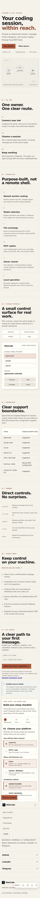
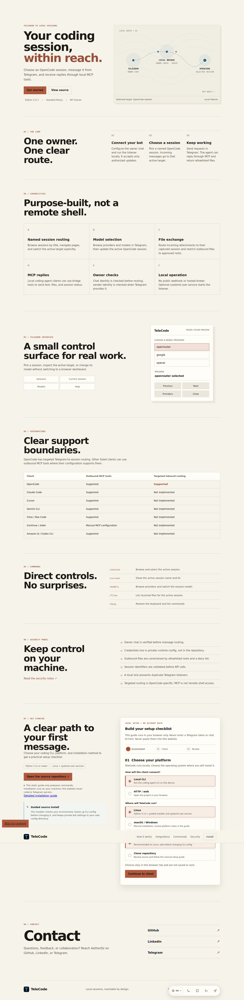
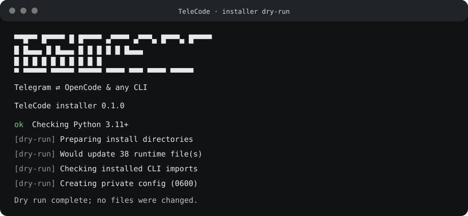
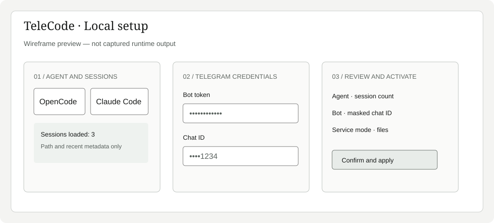
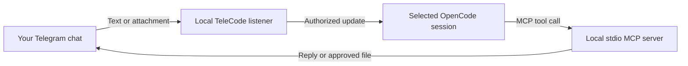

<p align="center">
  
</p>

<p align="center">
  <strong>Take your local coding-agent session with you.</strong><br>
  Send prompts from Telegram, choose a session, and receive agent replies in your owner chat.
</p>

<p align="center">
  <a href="LICENSE"></a>
  
  
  
</p>

<p align="center">
  <a href="https://aetherdz.github.io/telecode/">Website</a> ·
  <a href="docs/INSTALL.md">Installation</a> ·
  <a href="docs/CLI.md">CLI support</a> ·
  <a href="SECURITY.md">Security</a>
</p>

---

## See it in action

The responsive interface keeps the main navigation focused on the product while contact links live in a dedicated section.

| Mobile preview | Desktop preview |
| --- | --- |
|  |  |

## Feature overview

- **Telegram control:** send prompts and attachments from the authorized owner chat.
- **Session management:** browse, create, select, and inspect OpenCode sessions.
- **Model switching:** browse providers and models without editing local configuration.
- **MCP integration:** receive agent replies and approved files through local stdio tools.
- **Privacy by default:** no public web endpoint, owner-chat authorization, local credentials, and an allowlist for outgoing files.
- **Simple deployment:** Python standard library runtime, guided setup, foreground mode, and optional per-user startup service.

## What is TeleCode?

TeleCode connects your private Telegram chat to local coding-agent CLI workflows. Send a message or attachment to your bot, route it to the session you selected, and let the agent reply using the included MCP tools.

It is a deliberately narrow bridge: **no public web endpoint, no shell exposed to Telegram, and no extra model or prompt router in the message path.**

## Highlights

- **Control your OpenCode sessions from Telegram:** browse sessions, see the active target, and switch sessions without editing config files.
- **Create sessions on the go:** start a named OpenCode session from Telegram and immediately make it the active target.
- **Choose a model on the go:** browse providers and paginated model lists; apply a choice to the active OpenCode session.
- **Send context both ways:** route text, photos, and documents into the selected session; let the agent send text or approved local files back.
- **Use MCP-compatible clients:** outbound Telegram tools work through a local stdio MCP server. Inbound session routing currently requires OpenCode.
- **Keep the boundary local and private:** only the configured owner chat is accepted; credentials live in a private runtime config.
- **Install without a build step:** Python 3.11+ standard library runtime, guided setup, optional systemd/LaunchAgent/Task Scheduler startup, or foreground listener.
- **Readable terminal setup:** The Python CLI renders an aligned, keyboard-driven menu with plain ANSI styling and no third-party dependency; the shell installer keeps the same dependency-free approach.

## Quick start

### Requirements

- Linux with systemd, macOS with LaunchAgents, and Windows with Task Scheduler for per-user startup.
- Python 3.11 or newer and Git.
- A Telegram bot token from [@BotFather](https://t.me/BotFather).
- Your numeric Telegram chat ID, or the option to detect it by messaging your bot.
- OpenCode for Telegram-to-session prompt routing. Other MCP clients can use outbound tools; see [CLI support](docs/CLI.md).

### Install from source

```sh
git clone https://github.com/Aetherdz/telecode.git
cd telecode
./install.sh
```

Run `telecode` with no arguments for the Setup/Exit menu, or run `./install.sh` for the full guided setup. Setup registers the MCP server, stores credentials locally, and enables a per-user startup service (systemd on Linux, LaunchAgent on macOS, Task Scheduler on Windows). On headless systems where the OS service manager is unavailable, setup prints the foreground command (`telecode listen`). Review the source and [installation guide](docs/INSTALL.md) before running it. For a guided Linux setup from a terminal, use `curl -fsSL https://raw.githubusercontent.com/Aetherdz/telecode/main/install.sh | bash -s -- --curl-bootstrap`. For updates from a source checkout, use `./install.sh --update`.

### Browser setup

The interactive installer offers Browser (recommended) or Terminal. Select the
browser directly with `./install.sh --web` or `telecode setup --web`; use
`--cli` to retain the terminal wizard. The local wizard binds only to
`127.0.0.1`, uses a one-time link, and expires after 15 minutes. Remote shells
show an SSH port-forward hint. Session discovery displays metadata only and
remains manual where the format has not been verified.





There is no published npm/Bun package or `npx`/`bunx` installer yet. TeleCode is a Python application; the guided installer installs it locally and registers its MCP server with the client you choose. Do not use `npx aetherdz/telecode` or `bunx aetherdz/telecode` as if those package names were published.

After setup, restart your coding-agent CLI so it loads the MCP server. Check the bridge with:

```sh
telecode status
```

## How it works



The listener long-polls Telegram, checks incoming messages against the configured owner chat, stores accepted messages in the local inbox, and injects them into the selected session. The coding agent replies through `tg_send` or `tg_sendfile`. Create a session with `New session`; after you provide a name, TeleCode creates it through OpenCode and selects it for subsequent messages. Sessions from other project directories are included when visible to the OpenCode API.

## Telegram controls

| Control | What it does |
| --- | --- |
| `Sessions` / `/session` | Browse available sessions and select the active target. |
| `Current session` / `/current` | Show the active session and its ID. |
| `New session` | Enter a name, create an OpenCode session, and select it for subsequent messages. |
| `Enter session ID` / `/entersession` | Enter and verify a full OpenCode session ID, including one missing from the picker. |
| `Models` / `/models` | Browse providers and models, then switch the active OpenCode session. |
| `Help` / `/help` | Show available controls. |
| `/files` | List recent files received for the active session. |
| Any other text | Route the message to the active session. |

The keyboard labels are exact-match English text. The main keyboard uses Telegram's one-time hint; Telegram controls when keyboards are hidden, and `/menu` re-sends the main keyboard at any time. Closing or leaving a picker restores the main controls. Session selection is global to this bridge instance. Creating sessions requires the OpenCode API to be reachable. See [Buttons and commands](docs/BUTTONS.md) for picker behavior and edge cases.

Optional agent workflow: an OpenCode session with [`skills/telegram-interaction/SKILL.md`](skills/telegram-interaction/SKILL.md) available can be explicitly opted in by sending `/telegram` in the same authorized Telegram message as the task. It keeps work in the selected local session and routes concise responses via Telegram MCP. `/telegram` is not a bridge control command or button; without explicit opt-in in that task message, normal routing applies. See the [skill contract](skills/telegram-interaction/SKILL.md).

## MCP tools

| Tool | Purpose |
| --- | --- |
| `tg_send` | Send a text reply to the configured owner chat. |
| `tg_sendfile` | Send a local file from the configured `TG_SEND_ROOTS` allowlist. |
| `tg_read` | Read a bounded number of unread owner messages. |
| `tg_status` | Report bot, listener, session target, delivery mode, and unread count. |
| `tg_sessions` | List available OpenCode sessions. |
| `tg_select_session` | Select a session by its exact ID. |
| `tg_open_session_picker` | Send the session picker to Telegram. |

For safety, `tg_sendfile` rejects paths outside the configured allowlist and blocks sensitive locations. Telegram's hosted Bot API currently limits new uploads to **10 MB for photos** and **50 MB for other files**; a self-hosted Local Bot API Server can raise uploads to **2000 MB**, with additional hosting and bandwidth requirements. See [Telegram's official Bot API documentation](https://core.telegram.org/bots/api#using-a-local-bot-api-server) and TeleCode's [security notes](SECURITY.md).

## CLI support

| Client | Outbound MCP tools | Inbound session routing |
| --- | :---: | :---: |
| OpenCode | Yes | Yes — default adapter, sessions from any directory |
| Claude Code | Yes | Yes — headless `claude --resume` adapter (`TELECODE_AGENT=claude-code`) |
| Codex CLI | Yes | Experimental — set `TELECODE_AGENT=codex` |
| Cursor Agent CLI | Yes | Experimental — create/resume chats with `TELECODE_AGENT=cursor` |
| Gemini CLI, Cline, Roo Code, Amazon Q | Yes | No |
| Continue, Aider, other MCP clients | Manual setup | No |

MCP support and session-routing support are separate capabilities. Installing the MCP server in another client does **not** make that client an inbound Telegram target. Check [CLI integrations](docs/CLI.md) for setup details.

Codex inbound routing requires Codex CLI 0.166.0 or newer. It is experimental; local thread discovery, model listing, and queue delivery were smoke-tested on Linux. Generating an agent reply still requires a usable Codex account/session. See [the assumptions and limits](docs/CLI.md#codex-cli).
Cursor inbound routing requires the Cursor Agent CLI and `CURSOR_WORKSPACE` set to
the project directory for new chats. Existing chats across projects are best-effort
loaded from Cursor's local metadata, with **Open by ID** as a fallback.
See [Cursor](docs/CLI.md#cursor).

## Security model

- Incoming messages are accepted only from the configured owner chat; callback actions also verify the sender.
- The bot token and chat ID are kept in a user-owned `telegram.env` file with mode `0600`.
- `tg_sendfile` is confined to `TG_SEND_ROOTS` and a sensitive-path deny list.
- The listener uses a process lock to prevent competing Telegram pollers.
- Telegram messages and attachments are untrusted input; content is routed to the agent, not treated as trusted instructions by the bridge.

Read [SECURITY.md](SECURITY.md) for the full threat model and hardening guidance. Report vulnerabilities privately using the process described there.

## Documentation

- [Installation and startup](docs/INSTALL.md)
- [CLI integrations and configuration](docs/CLI.md)
- [Buttons and commands](docs/BUTTONS.md)
- [Telegram interaction skill](skills/telegram-interaction/SKILL.md)
- [Architecture and local state](docs/ARCHITECTURE.md)
- [Model catalogue and switching](docs/MODELS.md)
- [Roadmap](docs/ROADMAP.md)
- [Changelog](CHANGELOG.md)
- [Project website](https://aetherdz.github.io/telecode/)

## Development

The runtime has no third-party Python dependency. Run the repository checks before submitting changes:

```sh
make check
make test
```

`make check` runs Python compilation, shell and JavaScript syntax checks, and an HTML parse. `make test` runs the unittest suite.

## License

TeleCode is released under the [MIT License](LICENSE).
