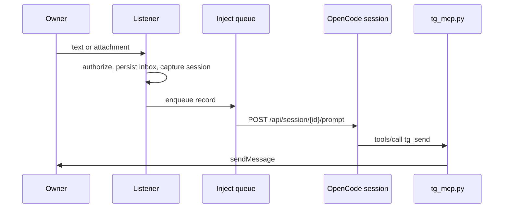

# Architecture

TeleCode is a small set of Python processes and files. There is no server socket, no
database, and no third-party runtime dependency. The bridge acts as a transport and
control plane; it does not interpret prompts.

## Components

| Component | File | Role |
| --- | --- | --- |
| Listener daemon | `tg_bridge.py listen` | Long-polls Telegram, authorizes updates, handles controls, stores messages, injects prompts. |
| Command-line interface | `tg_bridge.py` via `telecode` | `listen`, `read`, `wait`, `send`, `sendfile`, `status`, `--enable`, `--configure-cli`. |
| MCP stdio server | `tg_mcp.py` | Exposes the seven agent-facing tools over newline-delimited JSON-RPC. |
| Installer engine | `setup_cli.py` | Detects CLIs, validates config shape, backs up, writes atomically. |
| Shell installer | `install.sh` | Copies files, creates the launcher and private env template, optionally enables systemd. |
| Autostart installer | `install_autostart.sh` | Copies the core files and enables the user unit without the CLI picker. |
| Session adapter | `adapters/opencode.py` | Session listing and prompt delivery through the OpenCode CLI. |
| Claude Code adapter | `adapters/claude_code.py` | Fail-closed stub; raises on session listing and delivery. |

## Data flow

### Inbound

1. The listener starts, acquires `.listener.lock`, records `listener.pid`, sends the
   English reply keyboard, and starts one injection worker thread.
2. It calls `getUpdates` with a 50-second long poll and a 65-second HTTP timeout,
   accepting only `message` and `callback_query`.
3. For each update it compares the chat ID with `TG_CHAT_ID`. Callback queries also
   compare the sender ID. Messages compare the sender ID when one is present.
4. Control inputs are handled in-process and never reach the agent. This includes
   help, session picker, new-session naming prompt, model picker, file list, current
   session, pagination, and session selection. Creating a session calls OpenCode's
   `POST /api/session`, verifies the returned session, then persists it as the active
   target. A normal successfully routed message receives no extra
   acknowledgement; control commands may still produce their own response.
5. Other owner messages resolve the active session, download any document or photo
   into `files/<session-id>/`, append a record to `inbox.jsonl`, persist the Telegram
   offset, and enqueue the record.
6. The injection worker calls the OpenCode prompt endpoint with the configured
   delivery mode.

### Outbound

The agent calls MCP tools. `tg_mcp.py` starts on demand as a stdio subprocess of the
CLI, ensures the listener is running, and keeps stdout reserved for protocol frames.
`tg_send` and `tg_sendfile` post to the Telegram Bot API for the configured owner
chat. `tg_read` and `tg_status` read local state and the bot identity.



## Files on disk

The runtime directory is `${XDG_CONFIG_HOME:-$HOME/.config}/telegram-bridge`. The
code directory is `${XDG_DATA_HOME:-$HOME/.local/share}/telegram-bridge`.
`TELEGRAM_BRIDGE_HOME` overrides the runtime directory for all processes.

| Path | Format | Purpose | Protection |
| --- | --- | --- | --- |
| `telegram.env` | `KEY=VALUE` lines | Bot token, owner chat ID, delivery and discovery settings. | Regular file, mode `0600`, current user, not a symlink. |
| `inbox.jsonl` | JSON Lines | Append-only record of accepted owner messages and attachments. | Umask `0177`; file mode `0600`. |
| `offset.txt` | integer | Next Telegram update offset. | Mode `0600` via umask. |
| `cursor.txt` | integer | Last inbox `update_id` consumed by `tg_read` or `wait`. | Mode `0600` via umask. |
| `active-session.json` | JSON object | Selected target: `id`, `title`, `directory`. | Atomic replace, mode `0600`. |
| `models-cache.json` | JSON object | `saved` timestamp and normalized model list. | Temporary file chmod `0600`, then atomic replace. |
| `listener.pid` | integer | PID of the current listener, used for status. | Mode `0600` via umask. |
| `.listener.lock` | lock file | `fcntl.flock` guard for a single listener. | Mode `0600`. |
| `wake-session.txt` | session ID | Last session that accepted an injected prompt. | Mode `0600` via umask. |
| `files/<session-id>/` | directory | Downloaded documents and photos for that session. | Umask `0177`; per-session subdirectories. |

`active-session.json` schema:

```json
{
  "id": "ses...",
  "title": "Session title",
  "directory": "/home/user"
}
```

`inbox.jsonl` record schema:

```json
{
  "ts": 1760000000,
  "iso": "2026-10-28 12:00:00",
  "update_id": 123456,
  "chat_id": "123456789",
  "text": "message text or caption",
  "file": "/home/user/.config/telegram-bridge/files/ses.../1760000000000_123_name.pdf",
  "file_name": "name.pdf",
  "session_id": "ses..."
}
```

The `file` value is an empty string when the update had no attachment or the download
failed. A failed download is logged and the message is still routed.

## Session resolution

`resolve_session` returns a tuple of session ID and method:

1. `telegram-selected`: `active-session.json` contains a valid ID that still appears
   in the current list. A stale selection is deleted so it cannot route into another
   project.
2. `pinned`: `OPENCODE_SESSION_MODE=pin` and a valid `OPENCODE_SESSION_ID`.
3. `discovered`: the most recently updated root, non-archived session in the home
   directory.
4. `none`: no target; injection fails.

Session listing calls
`GET /api/session?order=desc&limit=1000&parentID=null&directory=<home>`. If that
request fails or returns no sessions, it retries without the directory filter and
filters on the client for root sessions, archive state, and directory. IDs are checked
with `ses[0-9A-Za-z_-]{6,80}` before persistence or use in a URL path.

## Concurrency

- **Single listener.** `cmd_listen` takes `LOCK_EX | LOCK_NB` on `.listener.lock`.
  A second listener exits with status 0 after closing its descriptor.
- **Autostart race control.** The MCP server opens the same lock, attempts a
  non-blocking exclusive lock, and spawns the listener in a new session. The child
  re-acquires the lock after the parent descriptor is released. If the lock is held,
  autostart returns without spawning.
- **Poll loop plus one worker.** Telegram polling is single-threaded. The injection
  worker consumes `queue.Queue` records sequentially, so prompt delivery order follows
  enqueue order.
- **Retry timer.** A failed injection is rescheduled by a daemon `threading.Timer` at
  a fixed 25-second interval, up to 12 retries. This is a fixed retry interval, not
  exponential backoff. After the final failure the record remains in `inbox.jsonl`.
- **Atomic state.** `active-session.json` is written to a sibling temporary file,
  fsynced, then replaced. The model cache uses a per-PID temporary file, chmod `0600`,
  then replace. The installer uses `mkstemp`, `fchmod`, `fsync`, `os.replace`, and a
  directory fsync.
- **Process umask.** `tg_bridge.py` sets `os.umask(0o077)` at import, so runtime files
  created without an explicit mode are owner-only.

## Failure handling

| Failure | Handling |
| --- | --- |
| Telegram poll error | Log to stderr, sleep 5 seconds, continue the loop. |
| Missing or invalid `telegram.env` | `load_env` raises before polling; the process exits. |
| Unauthorized chat or sender | Log and ignore; no inbox record and no injection. |
| Attachment download error | Log, store an empty `file`, still route the text. |
| Download over 20 MB | Abort the write and log; the message still routes without the file. |
| No active session | Injection fails and enters the retry queue. |
| `steer` delivery rejected | Retry the same prompt once with `queue` delivery. |
| Prompt delivery failure after retries | Record is retained in `inbox.jsonl`; no silent loss. |
| Session switch while queued | The record keeps its captured session ID; if that session vanished, the owner is notified and the record is not rerouted. |
| Model catalogue failure | Use `models-cache.json`; if empty, report the failure. |
| Model switch failure | Report a truncated error; no local state is changed. |
| Listener already running | Second process exits; the existing poller continues. |
| Stale PID file | Status reports `stale pid`; the file does not prevent a new listener. |

Offset durability has one narrow window: a crash after appending to `inbox.jsonl` but
before writing `offset.txt` can cause Telegram to redeliver the update, producing a
duplicate record and prompt. The reverse cannot lose an already stored message.

## Delivery modes

`TG_DELIVERY` accepts `steer` (default) and `queue`. `steer` asks OpenCode to run the
prompt at the next step boundary even while the session is busy; `queue` waits for the
current turn to end. Any other value is treated as `steer`. If `steer` fails, the
bridge retries once with `queue` before treating the delivery as failed.

## Trust boundaries

| Boundary | Assumption |
| --- | --- |
| Telegram to listener | Telegram Bot API is the only network ingress. Only the configured owner chat and sender are trusted; all text, captions, filenames, and file bytes are untrusted input. |
| Listener to OpenCode | The local `opencode` binary and its API are trusted. A local user who can replace the binary or call the API directly is outside the bridge's control. |
| Agent to MCP tools | The agent process is trusted to call tools, but tool arguments are still validated. Session IDs are regex-checked; file paths are resolved against `TG_SEND_ROOTS` and a deny list. |
| MCP to Telegram | Outbound text goes only to `TG_CHAT_ID`. There is no API for sending to another chat. |
| Runtime directory | Treated as private. `telegram.env` is checked for mode, owner, regular-file type, and symlink status on every load. Other runtime files rely on directory permissions and umask. |
| Local other users | Not authenticated by the bridge. The threat model assumes a single-user machine or a runtime directory not readable by other users. |

The systemd unit adds process hardening: `NoNewPrivileges`, `PrivateTmp`,
`ProtectSystem=full`, `ProtectHome=read-only`, and explicit `ReadWritePaths` for the
runtime and code directories. These reduce filesystem reach but do not sandbox the
agent or the OpenCode API.
